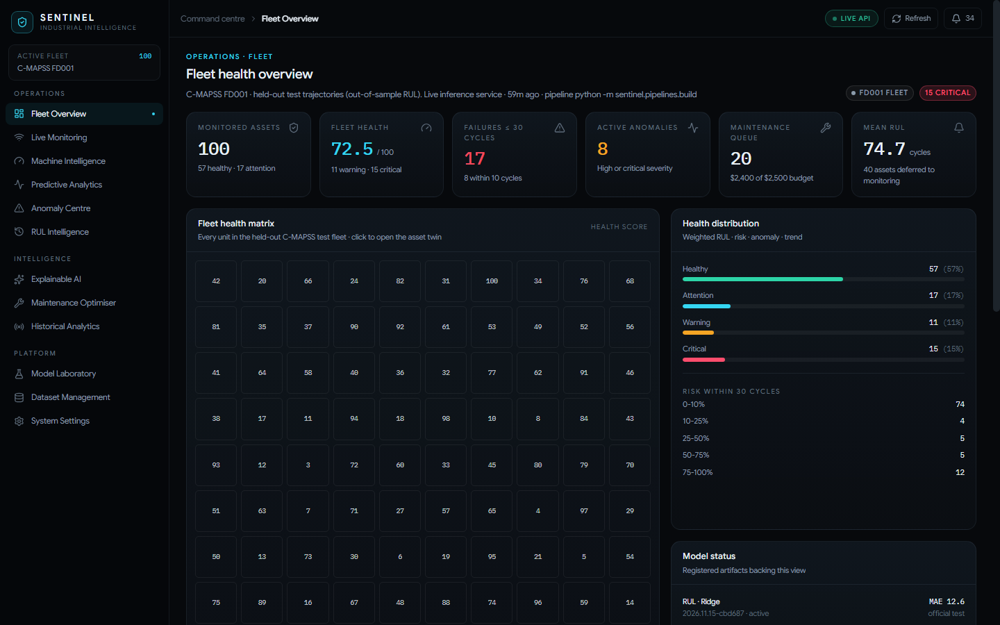
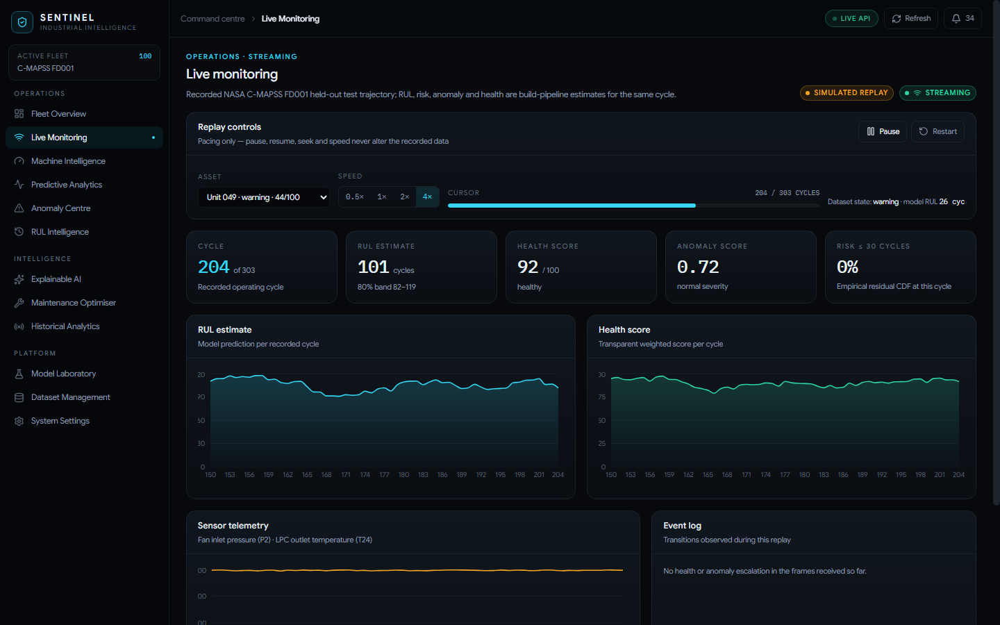
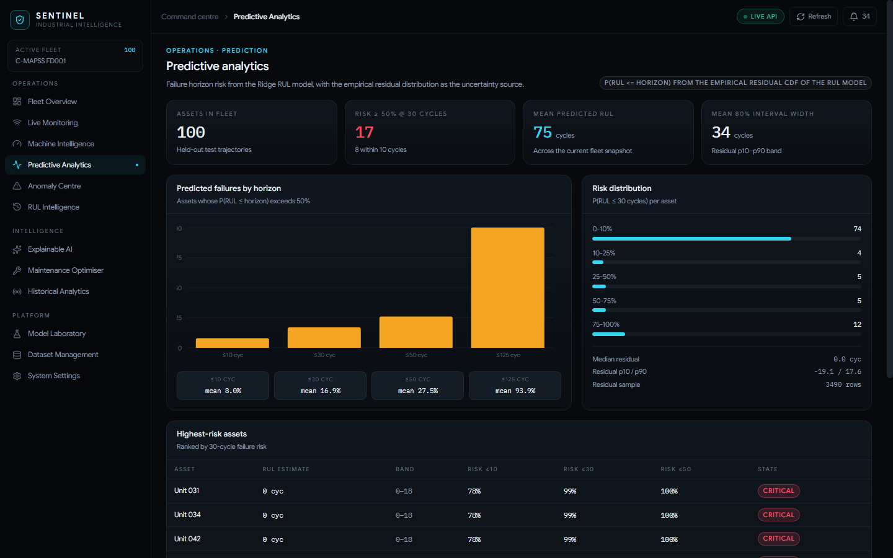
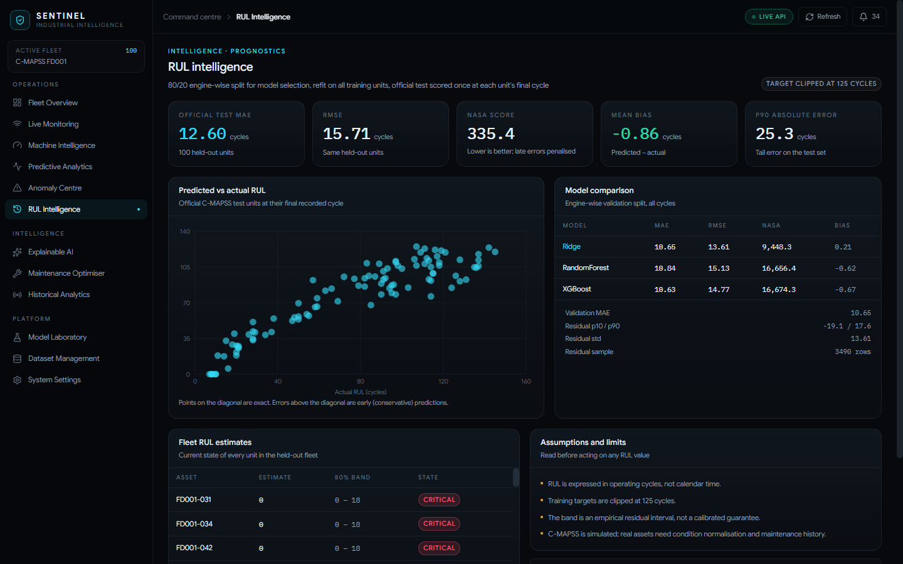
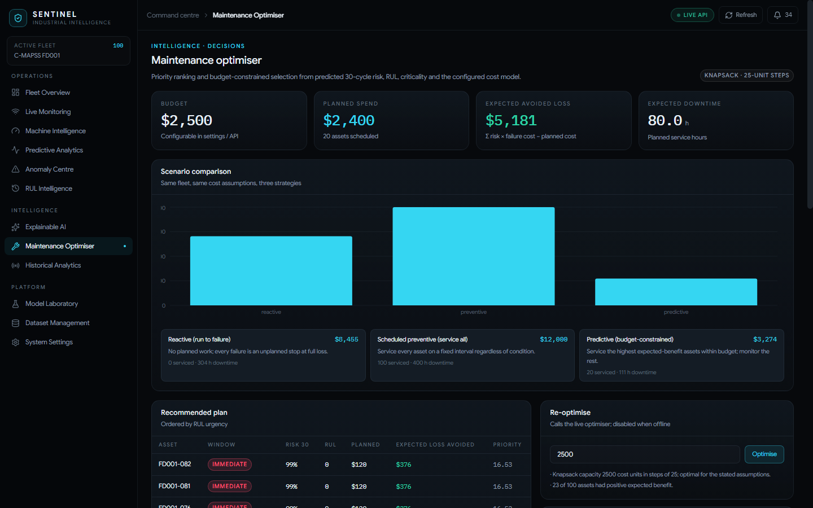
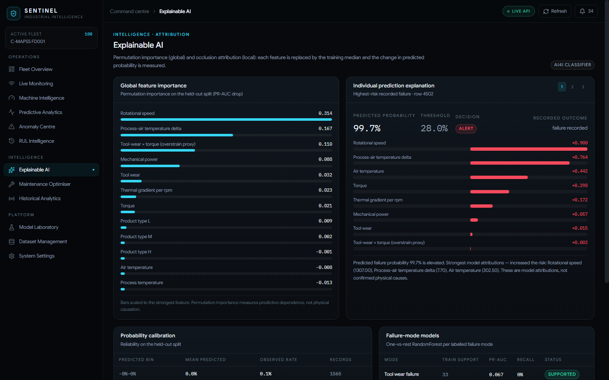
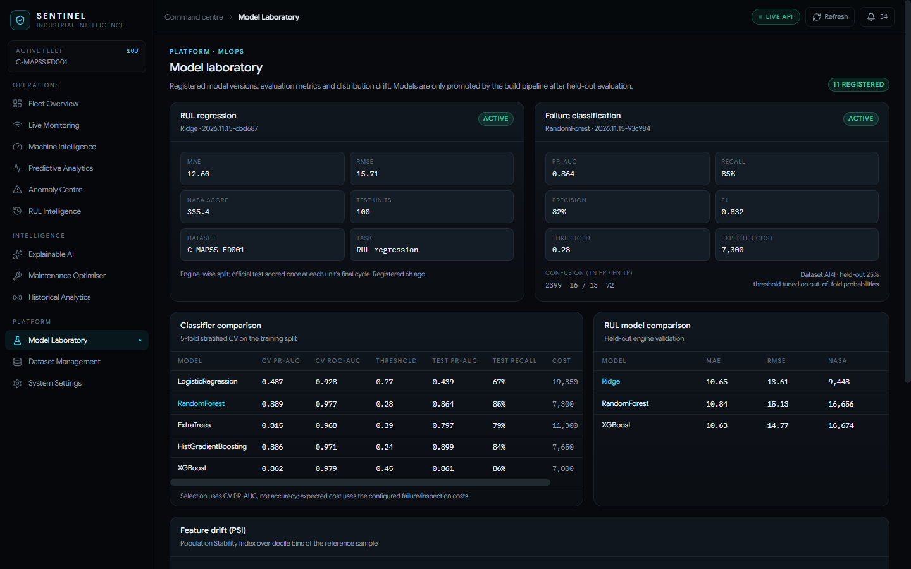

# SENTINEL

**Industrial Intelligence & Predictive Maintenance Platform**
*Predict Failure. Understand Risk. Optimize Operations.*

SENTINEL is an industrial AI command centre that turns raw machine telemetry into
validated data, predictions, explanations and budget-constrained maintenance
decisions. It is built as a real system — a Python data/ML backend, a FastAPI
service and a React operations console — on two public research datasets.


## What it does

| Question | Module | Implementation |
|---|---|---|
| What is happening? | Fleet telemetry | C-MAPSS sensor trajectories, per-cycle health history |
| Is it normal? | Anomaly centre | IsolationForest + LOF + PCA reconstruction, calibrated severity |
| Will it fail? | Failure prediction | 5-model comparison on AI4I 2020, cost-optimised threshold |
| When? | RUL intelligence | Ridge / RF / XGBoost, engine-wise split, NASA score, residual bands |
| Why? | Explainable AI | Permutation importance, occlusion attributions, reliability curve |
| What next? | Maintenance optimiser | Priority ranking + knapsack under budget, scenario costing |
| What will the sensor do? | Sensor forecasting | Statistical baselines and gradient boosting, chronological validation |
| Is it streaming? | Live monitoring | Recorded C-MAPSS replay over WebSocket, labelled simulated |

## Screenshots

Captured from the running console against the live FastAPI service (1440 × 900).

<table>
  <tr>
    <td width="50%">
      
      <br /><sub><b>Fleet overview</b> — 100 held-out engines, health distribution, 30-cycle failure risk.</sub>
    </td>
    <td width="50%">
      
      <br /><sub><b>Live monitoring</b> — recorded trajectory replayed over WebSocket at 4× with live RUL, health and anomaly estimates.</sub>
    </td>
  </tr>
  <tr>
    <td width="50%">
      
      <br /><sub><b>Predictive analytics</b> — assets above the 50% failure-risk threshold per horizon.</sub>
    </td>
    <td width="50%">
      
      <br /><sub><b>RUL intelligence</b> — predicted versus actual cycles, NASA score and residual band.</sub>
    </td>
  </tr>
  <tr>
    <td width="50%">
      
      <br /><sub><b>Maintenance optimiser</b> — knapsack plan under budget with reactive, preventive and predictive costing.</sub>
    </td>
    <td width="50%">
      
      <br /><sub><b>Explainable AI</b> — permutation importance, local attributions and calibration.</sub>
    </td>
  </tr>
  <tr>
    <td width="50%">
      
      <br /><sub><b>Model laboratory</b> — registry versions, metrics and dataset drift.</sub>
    </td>
    <td width="50%"></td>
  </tr>
</table>

## Verified results (this repository's build)

RUL regression on **NASA C-MAPSS FD001**, 80/20 engine-wise split, model refit on
all training units and scored once on the official test set:

| Model | Validation MAE | Validation RMSE | Validation NASA |
|---|---|---|---|
| **Ridge (selected)** | **10.65** | **13.61** | **9,448** |
| Random Forest | 10.84 | 15.13 | 16,656 |
| XGBoost | 10.63 | 14.77 | 16,674 |

Official test: **MAE 12.60 cycles, RMSE 15.71, NASA score 335.4** over 100 units.
The simple linear baseline wins on the asymmetric score — an honest negative
result for the tree ensembles, documented in `docs/MODEL_EVALUATION.md`.

Failure classification on **UCI AI4I 2020**, stratified 75/25 split, 5-fold CV:

| Model | CV PR-AUC | Test PR-AUC | Recall @ tuned threshold |
|---|---|---|---|
| **Random Forest (selected)** | **0.889** | 0.864 | **84.7%** |
| HistGradientBoosting | 0.886 | 0.899 | 84.0% |
| XGBoost | 0.862 | 0.861 | 86.0% |
| Extra Trees | 0.815 | 0.797 | 78.6% |
| Logistic Regression | 0.487 | 0.439 | 67.1% |

Failure rate is 3.39%; accuracy is never used as the selection metric. The
probability threshold is chosen on out-of-fold predictions by expected cost.

Sensor forecasting on the same C-MAPSS trajectories, chronological split inside
every engine (first 70% of cycles train, remaining 30% test):

| Forecast model | Mean MASE (h=1,5,10) |
|---|---|
| **Exponential smoothing (selected)** | **0.881** |
| Moving average (15) | 0.987 |
| Persistence | 1.061 |
| HistGradientBoosting | 1.054 |

MASE below 1 means the model beats the naive last-value forecast. Per-sensor MAE
is not averaged here because the channels have different units; it is reported
per sensor and horizon on the Forecasting page. Exponential
smoothing wins all 12 sensor × horizon cells; the boosted model is trained on
the change from the current value because trees cannot extrapolate sensor
levels, yet it still loses on the held-out tail — documented in
`docs/MODEL_EVALUATION.md`.

## Architecture

```
Vite + React 19 + TS + Tailwind 4 + Recharts (command centre)
        │  HTTP /api/v1, snapshot fallback
FastAPI (schemas, routers)  →  inference services  →  artifacts
        │
decision/ health scoring · knapsack maintenance planner
models/   RUL · classification · anomaly · explainability · registry
features/ causal rolling/lag/EMA pipeline
data/     AI4I & C-MAPSS adapters · validation · parquet
        │
SQLAlchemy store (SQLite local / PostgreSQL via env)
```

Full detail: `SYSTEM_ARCHITECTURE.md`, `docs/DATA_ARCHITECTURE.md`,
`docs/ML_METHODOLOGY.md`, `DECISIONS.md`.

## Quick start

Requirements: Python 3.11+, Node 20+ (or Bun), ~4 GB disk.

```bash
# 1. dependencies
python -m pip install -r requirements.txt
bun install

# 2. datasets (NASA PCoE mirror + UCI ML Repository)
python scripts/fetch_data.py

# 3. train, evaluate, export artifacts + platform snapshot (~2 min)
python -m sentinel.pipelines.build

# 4. API (http://127.0.0.1:8000/docs)
python -m uvicorn sentinel.api.main:app --port 8000

# 5. console (http://localhost:5173)
bun run dev
```

The console calls the API when it is reachable and otherwise reads
`src/generated/snapshot.json`, an artifact exported by the build pipeline. The
top bar always shows which source is active, so a static preview never pretends
to be live inference.

Live Monitoring streams recorded test-trajectory cycles from
`artifacts/replay.parquet` over a WebSocket (`/api/v1/ws/replay/{asset_id}`),
with pause, resume, seek and 0.5–4× speed. The UI labels the stream **Simulated
replay**; with the API offline it falls back to the exported per-asset series and
says so.

### Verification

```bash
python -m pytest -q      # data, features, metrics, decisions, API
bun run typecheck
bun run build
bun test tests
```

## Pages

Fleet Overview · Machine Intelligence · Machine Digital Twin · Predictive
Analytics · Live Monitoring · Anomaly Centre · RUL Intelligence · Explainable AI · Maintenance
Optimiser · Forecasting · Historical Analytics · Model Laboratory · Dataset Management ·
System Settings.

## Datasets

| Dataset | Use | Notes |
|---|---|---|
| [NASA C-MAPSS](https://data.nasa.gov/dataset/cmapss-jet-engine-simulated-data) | Fleet, RUL, anomaly, health, maintenance | Simulated turbofan run-to-failure; cycles, not calendar time |
| [UCI AI4I 2020](https://archive.ics.uci.edu/dataset/601/ai4i+2020+predictive+maintenance+dataset) | Failure + mode classification, explainability | Synthetic milling process; 3.39% failure rate |

They are never merged: different sensors, sampling and failure semantics.
Raw files are git-ignored and fetched by `scripts/fetch_data.py`; citations and
licence notes are in `docs/DATASET_DOCUMENTATION.md`.

## Repository layout

```
sentinel/            Python package (data, features, models, decision, inference, api, store, pipelines)
src/                 React console (design system, pages, charts, data layer)
tests/               pytest suite + worker tests
docs/                architecture, methodology, datasets, API, evaluation, design system
artifacts/           models, metrics, registry DB, snapshot (generated, git-ignored)
```

## Limitations (read before trusting any number)

- RUL is in operating cycles, clipped at 125, and its interval is an empirical
  residual band — not a guaranteed failure date.
- Health scores and cost assumptions are documented engineering judgement, not
  validated plant measurements.
- Anomaly severity is relative to an early-life healthy baseline.
- AI4I's power/overheat/overstrain labels are deterministic functions of the
  recorded channels, so near-perfect mode PR-AUC reflects label construction.
- No live sensor, MQTT or ESP32 integration exists; telemetry is recorded data.
- Deep learning (LSTM/GRU/CNN/Transformer) and MLflow are **not** implemented in
  this environment; they are tracked in `TASKS.md` (disk / CUDA PyTorch limit).

## Roadmap

Phases 0–5, Phase 7 and the replay part of Phase 6 are implemented and verified.
The Phase 8 portfolio pack is in progress: see
[`docs/TECHNICAL_REPORT.md`](docs/TECHNICAL_REPORT.md) for the full technical
report and [`docs/DEMO_SCRIPT.md`](docs/DEMO_SCRIPT.md) for the demo narrative
and three-minute walkthrough. Next: MLflow/retraining and the deep-learning lab.
See `DEVELOPMENT_ROADMAP.md` and `TASKS.md`.

## Attribution

C-MAPSS: A. Saxena, K. Goebel, D. Simon, N. Eklund, *Damage Propagation Modeling
for Aircraft Engine Run-to-Failure Simulation*, PHM 2008.
AI4I: S. Matzka, *Explainable Artificial Intelligence for Predictive Maintenance
Applications*, PHM Asia Pacific 2020 (UCI ML Repository, CC BY 4.0).
